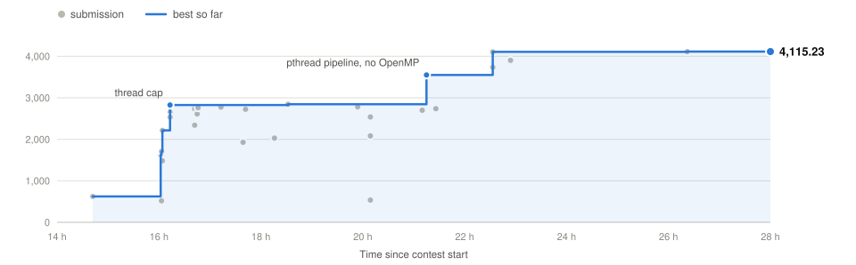

# A · Terrain flow and watersheds

**×4,115.23** · 62 s → 15.1 ms

<picture>
  <source media="(prefers-color-scheme: dark)" srcset="../docs/problem_A_dark.svg">
  
</picture>

## Problem

A DEM is read from stdin: a header (rows, columns, origin, cell size, nodata), then rows × columns floats. The program prints four grids, byte for byte like the C++ reference:

1. the terrain;
2. D8 flow directions (strictly lowest neighbour, reference tie-breaking);
3. flow accumulation (1 + sum of upstream cells);
4. watershed labels, numbered from 101 in first-encounter order.

The reference spends 77% of its time in iostream: 250 ns per float read, 234 ns per float written.

## Optimizations

| Step (ROMEO, fractal 8000²) | Time | Speedup |
|:--|--:|--:|
| Reference | 49.64 s | ×1 |
| O(V) accumulation | 42.09 s | ×1.18 |
| Fast output (`%g` reproduced) | 21.29 s | ×2.33 |
| Fast input (Clinger fast path) | 5.53 s | ×8.97 |
| OpenMP in every phase | 0.73 s | ×68 |
| `mmap` input, writer thread | 0.550 s | ×88 |

- **Exact I/O**
  - Parser: Clinger's fast path, exact for a mantissa < 2²⁴ and |e10| ≤ 10, falling back to `strtof` otherwise.
  - Output: glibc's `%g` reproduced and custom integer formatting, one `write()` per section.
- **O(V) accumulation**: in-degrees, then walks where the last arriving contributor carries on. The reference repeats full sweeps instead (121 at 8000², 3,000 on a north-west plane of 3000²).
- **Watersheds**: memoised root walks, labels from the rank of each basin's smallest index.
- **Fused pass**: parsing and terrain formatting in one pass, with no intermediate copy.
- **`dtm`, up to 4M cells**:
  - pinned pthreads created as a tree, futex barriers;
  - no OpenMP runtime, static libstdc++;
  - a single thread for small grids.
- **`dtm_par`, above 4M cells**: a separate pthread program started with `execv`.

| Grid (ROMEO) | OpenMP version | Final |
|:--|--:|--:|
| 1M cells | 12 ms | 6 ms |
| 4M cells | 21 ms | 14 ms |
| 16M cells | 46.0 ms | 18.8 ms |
| 64M cells | 102 ms | 42 ms |

## On BOCA

| Change | Zip | Speedup |
|:--|:--|--:|
| First submission | `A` | ×624 |
| Thread cap (16 threads instead of all 256) | `A_t16` | ×2,825 |
| Fused pthread pipeline, no OpenMP runtime | `A_fork2` | ×3,551 |
| Faster `%g` path | `A_fast10_nc` | ×4,108 |
| pthread `dtm_par` above 4M cells | `A_ys_nc` | ×4,115 |

<b>Tried and dropped</b>

 

| Idea | Result |
|:--|:--|
| All 256 threads on the judge | ×519 |
| `OMP_PROC_BIND` | 12–22% slower on ROMEO |
| Output through a shared `mmap` of stdout | 1.693 s vs 1.113 s at 12000² |
| Fortran core | ×2,082 |
| AVX2 assembly parser and formatter | no gain at the judge input size |

## Validation

- `%g` formatter checked against glibc on all 2³² float bit patterns.
- Parser checked against `strtof` on 10⁸ random tokens.
- Independent acceptance: 19,567 runs for `dtm`, 377/377 cases above 4M cells for `dtm_par`.

## Files

| File | Content |
|:--|:--|
| `all.h` | both programs |
| `dtm.cpp` | defines `A_PART_DTM`, includes `all.h` |
| `dtm_par.cpp` | includes `all.h` |
| `fastio.h` | parser and formatters |
| `Makefile`, `A` | build and run script |

`make all && ./A < input > output`

[← Back](../README.md) · [Full log](../docs/LOG.md#a-terrain-flow-and-watersheds)

