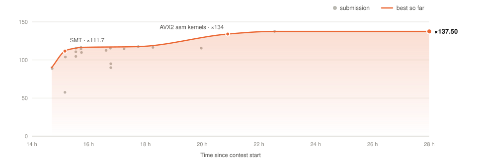

# B · 3D wave propagation

**×137.50** · 134 s → 0.975 s

<picture>
  <source media="(prefers-color-scheme: dark)" srcset="../docs/problem_B_dark.svg">
  
</picture>

## Problem

Acoustic wave on an N³ grid, with N ≤ 480 and T ≤ 160 time steps:

- c = 2,500 m/s, h = 12.5 m, Δt = 1 ms;
- 12th-order Laplacian, 6-layer zero frame;
- Ricker source (25 Hz) at (40, 48, 56);
- one in-place Gauss–Seidel sweep per step.

The output must be bit-exact, and `-ffp-contract=off` is mandatory: with FMA, input `84 3` gives `13.331983711912017` instead of `13.331994413740176`.

The reference takes 111 s on one Zen 4 core at (480, 160), 92% of it in the right-hand side.

## Optimizations

- **Barrier-free temporal pipeline**
  - (step, band) tasks chain across all steps, with up to 468 in flight at N = 480.
  - Step t computes plane k of band b once step t−1 has finished plane k+6 of band b and plane k of the highest band its rows reach. Three point-to-point acquire/release flags enforce it.
  - Schemes that synchronize at every step cap at ×13.4 (14 bands at N = 480).
  - Every point is computed with the reference's floating-point expression, so the bits are identical.
- **Band groups per L3**: each group has its own counter and first-touch memory (×1.10).
- **AVX2 assembly kernels** (`kern.S`): multiplies and adds stay separate, no FMA (about −13% on the judge).
- **Runtime settings**: SMT (`OMP_PLACES=threads`), active waiting, memory prepared with `MADV_POPULATE_WRITE`.
- **Flags**: those of the provided Makefile, plus `-fopenmp`.

| Threads (ROMEO, (480, 160)) | Pipeline, SSE | + AVX2 and groups |
|--:|--:|--:|
| 8 | 14.124 s | 11.239 s |
| 32 | 3.734 s | 3.144 s |
| 64 | 2.001 s | 1.712 s |
| 128 | 1.354 s | 1.158 s |
| 192 | 2.508 s | 1.207 s |

## On BOCA

| Change | Zip | Speedup |
|:--|:--|--:|
| First submission | `B_cpu` | ×89.9 |
| SMT | `B_cpu_smt` | ×111.7 |
| SMT tuning | `B_smt_d` | ×116.5 |
| AVX2 assembly kernels | `B_asmc` | ×134.0 |
| Memory setup, lower fixed costs | `B_fix` | ×137.5 |

<b>Tried and dropped</b>

 

| Idea | Result |
|:--|:--|
| GPU: bit-exact persistent CUDA kernel | 0.58 s on a GH200; not used on the judge |
| MPI | single host on the judge |
| Tiling along x | only active from N ≈ 877, above N ≤ 480 |
| 64 threads without SMT | ×57.5 |
| Socket-pinned groups | ×89.9 |

## Validation

- Acceptance: 782/782 fields exact.
- No FMA instruction in any binary (`objdump`).

## Files

| File | Content |
|:--|:--|
| `pulse.c` | pipeline, scheduling, I/O |
| `kern.S` | AVX2 kernels |
| `Makefile`, `B` | build and run script |

`make all && ./B < input > output`

[← Back](../README.md) · [Full log](../docs/LOG.md#b-3d-wave-propagation)

