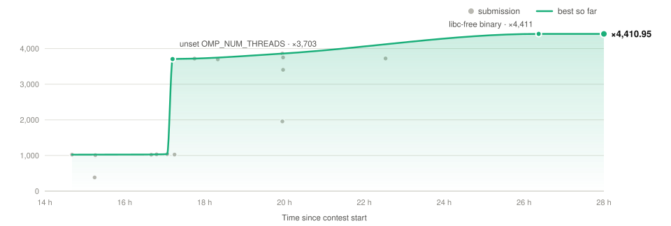

# C · Quadtree range query

**4,410.95** · 24 s → 5.4 ms

<picture>
  <source media="(prefers-color-scheme: dark)" srcset="../docs/problem_C_dark.svg">
  
</picture>

### Optimizations

- Only the nodes reached by the query are built
- glibc `rand()` emulation with exact jump-ahead: 16 parallel substreams
- AVX2 assembly kernel for point generation (`p1asm.S`)
- `%.1f` formatter
- Thread count chosen per phase
- Static libc-free binary (raw syscalls, `clone`, futex), with `qtd` (glibc build) as fallback via `execve`
- `unset OMP_NUM_THREADS` in the script

### Files

| File | Content |
|:--|:--|
| `qc.h` | both programs |
| `qf.c` | defines `QF`: libc-free `qt` |
| `qt.c` | glibc fallback `qtd` |
| `p1asm.S` | AVX2 generation kernel |
| `Makefile`, `C` | build and run script |

[← Back](../README.md) · [Details in the log](../docs/LOG.md#c-quadtree-range-query)

