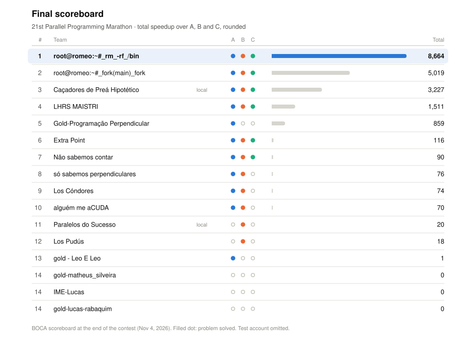

# 21st Parallel Programming Marathon · SSCAD 2026

**#1** · team `root@romeo:~#_rm_-rf_/bin` · total speedup **×8,663.68**

<picture>
  <source media="(prefers-color-scheme: dark)" srcset="docs/scoreboard_dark.svg">
  
</picture>

| Problem | Speedup |
|:--|--:|
| [A · Terrain flow and watersheds](A/) | ×4,115.23 |
| [B · 3D wave propagation](B/) | ×137.50 |
| [C · Quadtree range query](C/) | ×4,410.95 |

[Problem set](problemset.pdf) · [Log](docs/LOG.md) · [Submissions](submissions/)

