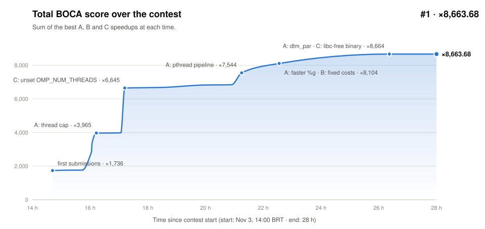
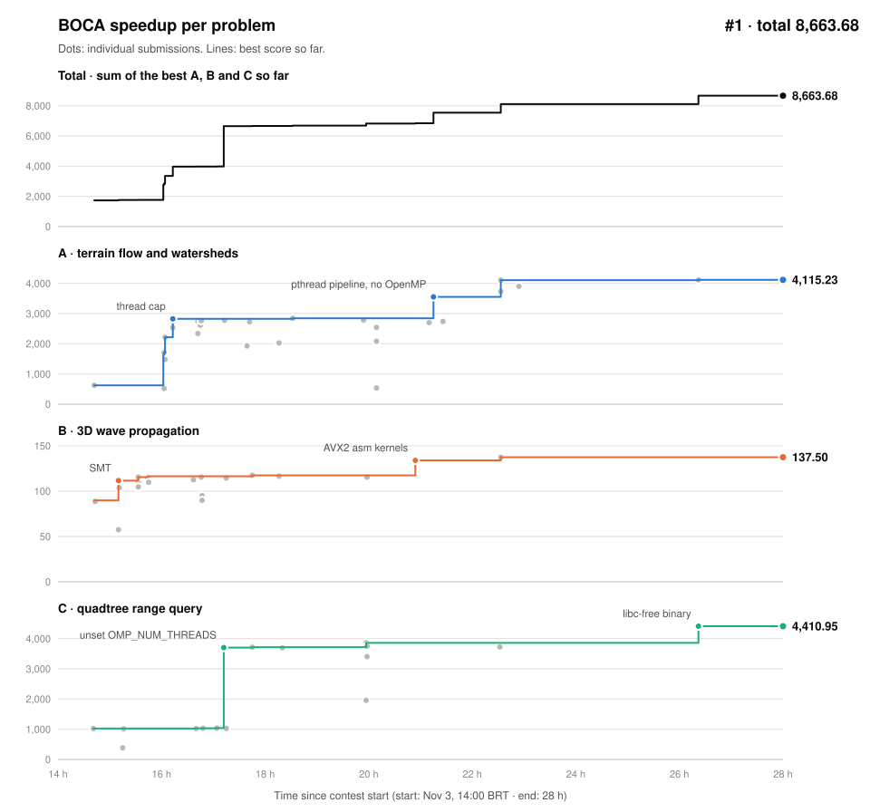

# Log

<picture>
  <source media="(prefers-color-scheme: dark)" srcset="total_score_dark.svg">
  
</picture>

<picture>
  <source media="(prefers-color-scheme: dark)" srcset="boca_scores_dark.svg">
  
</picture>

Local measurements on ROMEO (2× AMD EPYC 9654). Judge: AMD EPYC 7713, GCC 9.4.

## A: terrain flow and watersheds

ROMEO, fractal 8000²:

| Step | Time | Speedup |
|---|---|---|
| Reference | 49.64 s | 1× |
| O(V) accumulation | 42.09 s | 1.18× |
| Fast output (`%g` reproduced) | 21.29 s | 2.33× |
| Fast input (Clinger fast path) | 5.53 s | 8.97× |
| OpenMP everywhere | 0.73 s | 68× |
| `mmap` input, writer thread | 0.550 s | 88× |

BOCA:

| Change | Speedup |
|---|---|
| First submission | 624 |
| Thread cap | 2,825 |
| Fused pthread pipeline, no OpenMP (≤ 4M cells) | 3,551 |
| Faster `%g` path | 4,108 |
| pthread `dtm_par` above 4M cells (0.40× time on ROMEO) | 4,115 |

## B: 3D wave propagation

ROMEO, (N, T) = (480, 160):

| Step | Time | Speedup |
|---|---|---|
| Reference, one Zen 4 core | 111.14 s | 1× |
| Per-step synchronization (model cap) | | 13.4× |
| Temporal pipeline, 128 threads | 1.354 s | 82× |
| + socket groups, AVX2 (judge emulation, 64+64 cores) | 1.026 s | 108× |

BOCA:

| Change | Speedup |
|---|---|
| First submission | 89.9 |
| SMT | 111.7 |
| SMT tuning | 116.5 |
| AVX2 assembly kernels | 134.0 |
| Memory setup, lower fixed costs | 137.5 |

## C: quadtree range query

ROMEO, example query, 10⁷ points:

| Step | Time | Speedup |
|---|---|---|
| Reference | 8.86 s | 1× |
| Tail pointer, arena, parallel generation | 5.79 s | 1.53× |
| Query-limited construction, 16-way integer generation, thread caps | 6.3 ms | 1,406× |

BOCA:

| Change | Speedup |
|---|---|
| First submission | 1,023 |
| `unset OMP_NUM_THREADS` (judge exports 1) | 3,703 |
| AVX2 assembly kernel | 3,859 |
| libc-free static binary (10⁸ points on ROMEO: 5.50 → 4.35 ms) | 4,411 |

## BOCA history

Time since contest start. Only submissions that raised a problem's best score are listed.

| Time | Problem | Zip | Speedup |
|---|---|---|---|
| 14h41 | C | `C` | 1,022.71 |
| 14h42 | A | `A` | 623.86 |
| 14h42 | B | `B_cpu` | 89.93 |
| 15h10 | B | `B_cpu_smt` | 111.67 |
| 15h33 | B | `B_smt_b` | 115.52 |
| 15h44 | B | `B_smt_d` | 116.52 |
| 16h04 | A | `A_t64` | 2,215.95 |
| 16h13 | A | `A_t16` | 2,825.37 |
| 17h12 | C | `C_unset` | 3,703.13 |
| 17h45 | B | `B_smt_d` | 117.54 |
| 18h32 | A | `A_fast3` | 2,845.47 |
| 19h57 | C | `C_asm` | 3,859.14 |
| 20h54 | B | `B_asmc` | 134.00 |
| 21h15 | A | `A_fork2` | 3,550.97 |
| 22h33 | A | `A_fast10_nc` | 4,107.86 |
| 22h33 | B | `B_fix` | 137.50 |
| 26h22 | A | `A_ys_nc` | 4,115.23 |
| 26h22 | C | `C_free_s` | 4,410.95 |

Final: A 4,115.23 + B 137.50 + C 4,410.95 = **8,663.68, #1**.

Speedups are the organizers' re-timed values; before the re-timing, BOCA truncated times to 10 ms.
