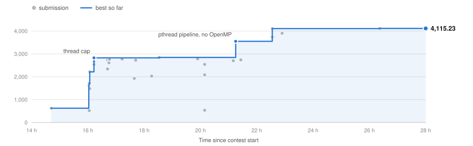
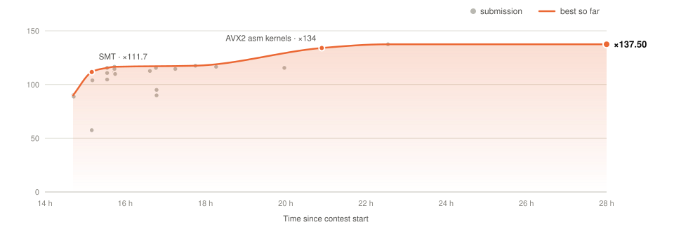
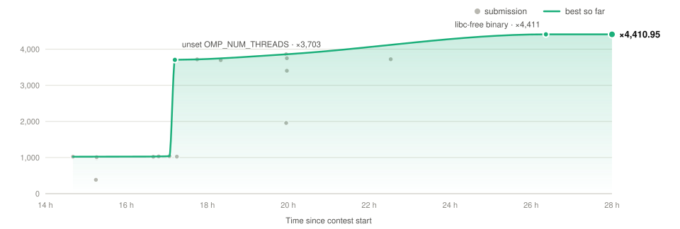
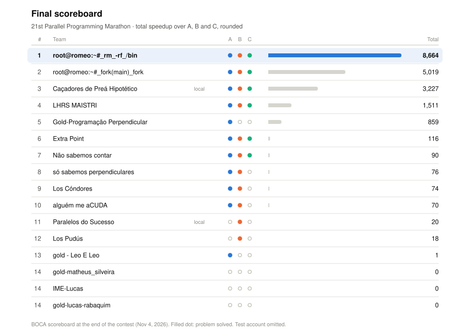

# Log

<picture>
  <source media="(prefers-color-scheme: dark)" srcset="total_score_dark.svg">
  
</picture>

| Problem | t_ref | Final time | Speedup |
|:--|--:|--:|--:|
| A · Terrain flow and watersheds | 62 s | 15.1 ms | ×4,115.23 |
| B · 3D wave propagation | 134 s | 0.975 s | ×137.50 |
| C · Quadtree range query | 24 s | 5.4 ms | ×4,410.95 |
| **Total** | | | **×8,663.68** |

[Environment](#environment) · [A](#a-terrain-flow-and-watersheds) · [B](#b-3d-wave-propagation) · [C](#c-quadtree-range-query) · [History](#boca-history)

---

## Environment

| | Judge | Local (ROMEO) |
|:--|:--|:--|
| CPU | AMD EPYC 7713 (Zen 3), 128 cores / 256 threads | 2× AMD EPYC 9654 (Zen 4), 192 cores |
| Compiler | GCC 9.4 | GCC 9.4 (judge version), GCC 11.5 |

- Score = t_ref / t, mean of 3 runs. Only the last submission of each problem counts.
- The judge exports `OMP_NUM_THREADS=1`. Scripts must unset it to get more than one OpenMP thread.
- BOCA rejects zips above ≈ 32 KB, checked in the browser before upload.
- Until Nov 4, 16:29 (Paris), BOCA truncated times to 10 ms: A was capped at ×3,100 (0.02 s) and C at ×24,000,000 (0.00 s, floor 1e-6). The organizers then re-timed every submission precisely. All speedups below are the re-timed values.
- A Makefile that ran a self-test during `make` came back as a compilation error. Later Makefiles only compile, with a `||` fallback on each link line.

---

## A: Terrain flow and watersheds

**×4,115.23** · 62 s → 15.1 ms

<picture>
  <source media="(prefers-color-scheme: dark)" srcset="problem_A_dark.svg">
  
</picture>

D8 flow directions, flow accumulation and watershed labels on a DEM read from stdin. Four text grids on stdout, matching the reference byte for byte.

### Reference profile

| Phase (ROMEO, fractal 8000²) | Time |
|:--|--:|
| Read (`cin >> float`) | 16.10 s |
| Write terrain | 14.99 s |
| Directions + write | 0.52 + 2.32 s |
| Accumulation (121 sweeps) | 9.00 s |
| Write accumulation + watersheds | 2.38 + 2.75 s |
| Watersheds | 1.54 s |
| **Total** | **49.65 s** |

iostream costs 250 ns per float read and 234 ns per float written. On a north-west plane, the sweep count grows with the grid side (3,000 sweeps, 84 s at 3000²).

### Steps

| Step (ROMEO, fractal 8000²) | Time | Speedup |
|:--|--:|--:|
| Reference | 49.64 s | ×1 |
| O(V) accumulation: in-degrees, last arriving contributor continues the walk | 42.09 s | ×1.18 |
| Fast output: custom integers, `%g` reproduced, one `write()` per section | 21.29 s | ×2.33 |
| Fast input: whole stdin, Clinger fast path | 5.53 s | ×8.97 |
| OpenMP in every phase | 0.73 s | ×68 |
| `mmap` stdin, writer thread overlapping output, 32 threads | 0.550 s | ×88 |

On large grids the single output stream dominates (2.8–3.0 GB/s), so time is lowest near 32 threads. The judge input is much smaller, so the last versions target fixed costs instead.

| Grid (ROMEO) | OpenMP (`A_fast9`) | pthread pipeline (`A_fork2`) | Final `dtm` |
|:--|--:|--:|--:|
| 1M cells | 12 ms | 7 ms | 6 ms |
| 4M cells | 21 ms | 18 ms | 14 ms |

| Grid (ROMEO), handed to `dtm_par` | OpenMP `dtm_par` | pthread `dtm_par` (final) |
|:--|--:|--:|
| 8M cells | 32.8 ms | 13.7 ms |
| 16M cells | 46.0 ms | 18.8 ms |
| 64M cells | 102 ms | 42 ms |

### On BOCA

| Change | Zip | Speedup |
|:--|:--|--:|
| First submission | `A` | ×624 |
| Thread cap (16 threads instead of all 256) | `A_t16` | ×2,825 |
| Pipeline tuning | `A_fast3` | ×2,845 |
| Fused pthread pipeline, no OpenMP runtime (≤ 4M cells) | `A_fork2` | ×3,551 |
| Faster `%g` path | `A_fast10_nc` | ×4,108 |
| pthread `dtm_par` above 4M cells | `A_ys_nc` | ×4,115 |

<b>Tried and dropped</b>

 

| Idea | Result |
|:--|:--|
| All 256 threads on the judge | ×519 (vs ×2,825 at 16 threads) |
| `OMP_PROC_BIND` | 12–22% slower on ROMEO |
| `OMP_WAIT_POLICY=passive` | −3 to +5% |
| Output through a shared `mmap` of stdout | 1.693 s vs 1.113 s at 12000² |
| Fortran core (`A_ftn`) | ×2,082 |
| AVX2 assembly parser and formatter | no gain at the judge input size |
| GPU | nothing to offload: the run is I/O and fixed costs |

### Validation

- `%g` formatter checked against glibc on all 2³² float bit patterns.
- Parser checked against `strtof` on 10⁸ random tokens and 1.1·10⁹ round trips.
- Independent acceptance: 19,567 runs for `dtm`, 377/377 cases above 4M cells for `dtm_par`.

---

## B: 3D wave propagation

**×137.50** · 134 s → 0.975 s

<picture>
  <source media="(prefers-color-scheme: dark)" srcset="problem_B_dark.svg">
  
</picture>

Acoustic wave on an N³ grid (N ≤ 480, T ≤ 160): c = 2,500 m/s, h = 12.5 m, Δt = 1 ms, 12th-order Laplacian, 6-layer zero frame, Ricker source at (40, 48, 56). Each step is one in-place Gauss–Seidel sweep. The output must be bit-exact and `-ffp-contract=off` is mandatory.

### Reference profile

- (480, 160) takes 111.14 s on one Zen 4 core: 6.8 ns per point update.
- The right-hand side (`gs_rhs`) is about 92% of a sweep.
- 1.63·10¹⁰ updates × ≈ 110 flops ≈ 1.8 TFLOP.
- With FMA contraction, input `84 3` gives a checksum of `13.331983711912017` instead of `13.331994413740176`.

### Dependencies

Step t can compute plane k of band b once step t−1 has finished plane k+6 of band b and plane k of the highest band reached by rows j₁..j₁+5. Any order that respects this graph evaluates the same expressions, so the bits are identical.

### Steps

| Step (ROMEO, (480, 160)) | Time | Speedup |
|:--|--:|--:|
| Reference, one core | 111.14 s | ×1 |
| Per-step barriers or tasks (14 bands at N = 480) | | ×13.4 cap (model) |
| Temporal pipeline: (step, band) tasks, three point-to-point flags, up to 468 tasks in flight, 128 threads | 1.354 s | ×82 |
| + socket groups (×1.10) and AVX2 clones (×1.18), judge emulation 64+64 cores | 1.026 s | ×108 |

| Threads (ROMEO) | Pipeline, SSE, one queue | + AVX2 and socket groups | Model |
|--:|--:|--:|--:|
| 8 | 14.124 s | 11.239 s | ×8.0 |
| 32 | 3.734 s | 3.144 s | ×31.6 |
| 64 | 2.001 s | 1.712 s | ×62.6 |
| 96 | 1.609 s | 1.332 s | ×91.7 |
| 128 | 1.354 s | 1.158 s | ×121.3 |
| 192 | 2.508 s | 1.207 s | ×179.8 |

### On BOCA

| Change | Zip | Speedup |
|:--|:--|--:|
| First submission | `B_cpu` | ×89.9 |
| SMT | `B_cpu_smt` | ×111.7 |
| SMT tuning | `B_smt_d` | ×116.5 |
| AVX2 assembly kernels, no FMA | `B_asmc` | ×134.0 |
| Memory setup (`MADV_POPULATE_WRITE`), lower fixed costs | `B_fix` | ×137.5 |

<b>Tried and dropped</b>

 

| Idea | Result |
|:--|:--|
| GPU: bit-exact persistent CUDA kernel, no grid barrier | 0.58 s on a GH200; not used on the judge |
| MPI | single host on the judge |
| Tiling along x (`B_xtf`) | only active from N ≈ 877, above the statement's N ≤ 480 |
| 64 threads without SMT | ×57.5 |
| Socket-pinned groups (`B_smt_sock`) | ×89.9 |
| Bands of 8–24 rows, 8- or 16-lane chains, diagonal kernel | slower on ROMEO |

### Validation

- Acceptance: 782/782 fields exact.
- No FMA instruction in any binary (`objdump`).

---

## C: Quadtree range query

**×4,410.95** · 24 s → 5.4 ms

<picture>
  <source media="(prefers-color-scheme: dark)" srcset="problem_C_dark.svg">
  
</picture>

n points from glibc's `rand()` (`srand(42)`), a quadtree with at most 4 points per leaf, then a rectangular query printed as `(%.1lf,%.1lf)`.

- The reference `intercept()` only tests corners and prunes nodes that do overlap the query. A correct geometric test would give a different output.
- FMA contraction of `x*W + x_min` changes 10,262,024 of 2·10⁷ coordinates, so `-ffp-contract=off` is required.
- `%.1lf` rounds the exact binary value half to even and prints `-0.0` for small negatives.

### Reference profile

- Construction is superlinear: 0.89 µs per point at 10⁷, 1.7 µs at 10⁸.
- The result list is Θ(m²).
- Memory: 121 bytes per point (12.1 GB at 10⁸).

### Steps

| Step (ROMEO) | Example, 10⁷ | 1% query, 2·10⁷ | Example, 3·10⁷ |
|:--|--:|--:|--:|
| Reference | 8.861 s | 42.135 s | 35.318 s |
| Tail pointer | 8.528 s | 19.894 s | 32.380 s |
| + contiguous arena, `_exit` | 5.891 s | 13.520 s | 21.846 s |
| + parallel generation | 5.791 s | 13.447 s | 21.274 s |
| Query-limited construction, 16-way integer generation, thread caps, exact formatter | **6.3 ms** | **90 ms** | **10.3 ms** |

- **Query-limited construction**: a node is built only if `intercept()` succeeds on its whole path from the root, so the false prunings are reproduced by construction.
- **Generation**: glibc TYPE_3 emulation with exact jump-ahead (x^j mod x³¹ − x²⁸ − 1, ≈ 15 µs per jump), 16 interleaved substreams per block, integer thresholds on `rand() % 10⁶`. Cost: 12.5 → 1.0–1.2 ns per point per thread.
- **Fixed costs**: an empty C program takes 1.2 ms to start; an OpenMP team costs ≈ 37 µs per thread (4.62 ms for 128). Each phase sizes its own thread count from its work.

| n (ROMEO, example query) | glibc build (`C_asm`) | libc-free (`C_free_s`) |
|--:|--:|--:|
| 10³ | 1.76 ms | 1.49 ms |
| 10⁶ | 2.16 ms | 1.76 ms |
| 10⁷ | 2.89 ms | 2.34 ms |
| 10⁸ | 5.50 ms | 4.35 ms |
| 10⁹ | 15.33 ms | 12.35 ms |

### On BOCA

| Change | Zip | Speedup |
|:--|:--|--:|
| First submission | `C` | ×1,023 |
| `unset OMP_NUM_THREADS` | `C_unset` | ×3,703 |
| AVX2 assembly kernel for generation | `C_asm` | ×3,859 |
| libc-free static binary, `qtd` fallback | `C_free_s` | ×4,411 |

<b>Tried and dropped</b>

 

| Idea | Result |
|:--|:--|
| Futex waits instead of spinning (`C_nospin`) | ×384 |
| One thread (`C_t1`) | ×984 |
| Fortran core (`C_ftn`) | ×1,956 |
| A parallel region over the whole machine | ≈ 6 ms slower on ROMEO |

### Validation

- `rand()` emulation checked against glibc 2.34 on 2·10⁸ consecutive values and 55 seeds.
- `%.1f` formatter checked against `snprintf` on 29,797,555 values.
- Acceptance: 33,441 runs on 8,610 inputs.

---

## BOCA history

<picture>
  <source media="(prefers-color-scheme: dark)" srcset="scoreboard_dark.svg">
  
</picture>

| Time | Problem | Zip | Speedup |
|--:|:-:|:--|--:|
| 14h41 | C | `C` | ×1,022.71 |
| 14h42 | A | `A` | ×623.86 |
| 14h42 | B | `B_cpu` | ×89.93 |
| 15h10 | B | `B_cpu_smt` | ×111.67 |
| 15h33 | B | `B_smt_b` | ×115.52 |
| 15h44 | B | `B_smt_d` | ×116.52 |
| 16h02 | A | `A_spin30k` | ×1,629.43 |
| 16h03 | A | `A_t128` | ×1,708.74 |
| 16h04 | A | `A_t64` | ×2,215.95 |
| 16h13 | A | `A_t16` | ×2,825.37 |
| 16h39 | C | `C_pad10` | ×1,028.01 |
| 16h48 | C | `C_t4` | ×1,030.93 |
| 17h04 | C | `C` | ×1,036.76 |
| 17h12 | C | `C_unset` | ×3,703.13 |
| 17h45 | B | `B_smt_d` | ×117.54 |
| 18h32 | A | `A_fast3` | ×2,845.47 |
| 19h57 | C | `C_asm` | ×3,859.14 |
| 20h54 | B | `B_asmc` | ×134.00 |
| 21h15 | A | `A_fork2` | ×3,550.97 |
| 22h33 | A | `A_fast10_nc` | ×4,107.86 |
| 22h33 | B | `B_fix` | ×137.50 |
| 26h22 | A | `A_ys_nc` | ×4,115.23 |
| 26h22 | C | `C_free_s` | ×4,410.95 |

Submissions that raised a problem's best score, time since contest start. 
All 98 runs, with their zips: [submissions](../submissions/).

